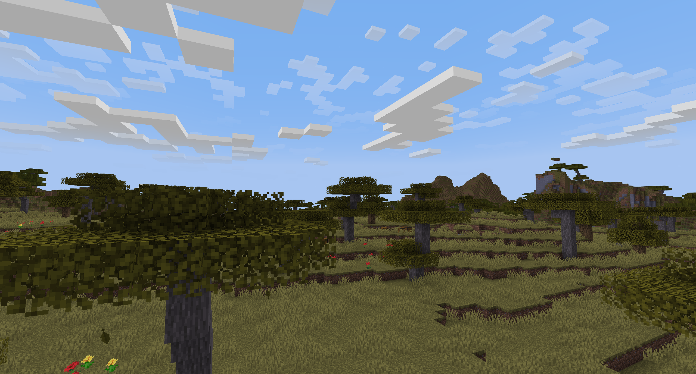
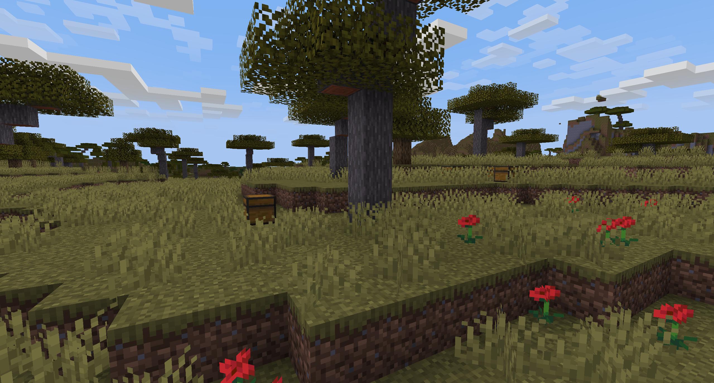
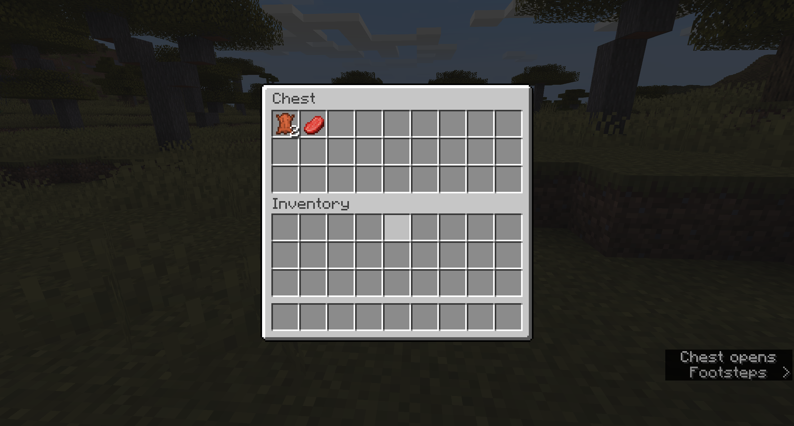
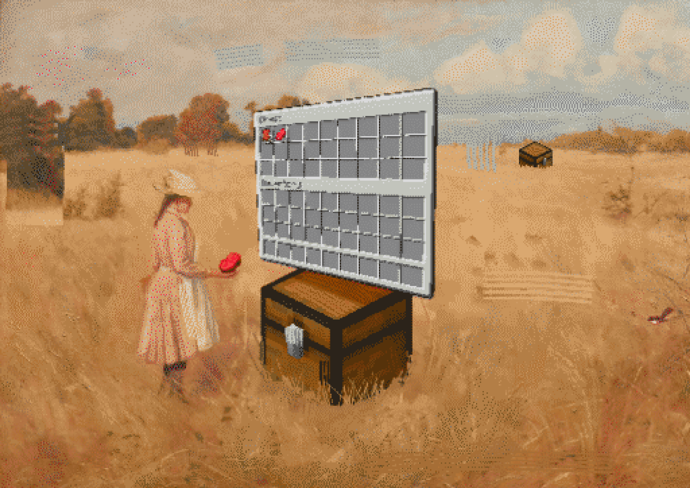

# the world of chests

what if _every living thing_ in the known world...

...was a chest?

I woke up one morning and such was my reality.

this is my story...

> [!TIP]
> this is a true story

> [!WARNING]
> it can happen to you

___

*ah, just another normal minecraft world. let's look around a bit.*

> [!IMPORTANT]
> it was not a normal minecraft world
___

*how odd, there seem to be some chests up here. perhaps broken mineshaft generation...? but wait...that isn't possible...*

> [!NOTE]
> that might be possible
___

*what the...the remains of a cow...but how!? I must be dreaming...*

> [!TIP]
> cows contain beef and leather, similar to the way they are known to be mostly made of those things in real life

_come, dear reader, and join me..._

**in the world of chests...**

---

# installation instructions

## for n00bz:
- [click here to go to the releases page](https://github.com/jpegzilla/world-of-chests/releases)
- go to the [latest release](https://github.com/jpegzilla/world-of-chests/releases/latest)
- click the `.zip` file with `world-of-chests` in the name (or the one called "source code")
- un`.zip` the `.zip` if that's how you roll
- create a minecraft world and quit the world
- open the minecraft world's folder
- in the `/datapacks/` folder, paste in the thing you downloaded
- load up your game again
- experience the true nature of this world...my world...of _CHESTS_.

## credits

promo image is called "a token of friendship" by arthur collingridge: https://www.artgallery.nsw.gov.au/collection/works/4620/

minecraftification and chestastisizing by me

## todo

- [x] when breaking the chest spawned by swap.mcfunction, kill the associated mob
  - every entity has an ID
  - attach the ID of the mob to the chest upon spawning the chest
  - when the chest is destroyed, use the stored entity ID to kill the mob
- [ ] figure out how to make the mob actually hidden
- [ ] make sure all the entities that shouldn't turn into chests (like throwable items and stuff) don't turn into chests
